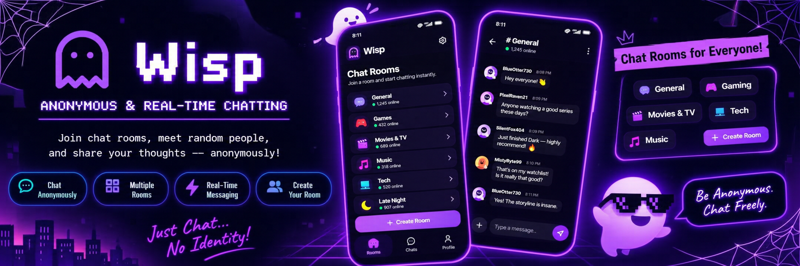
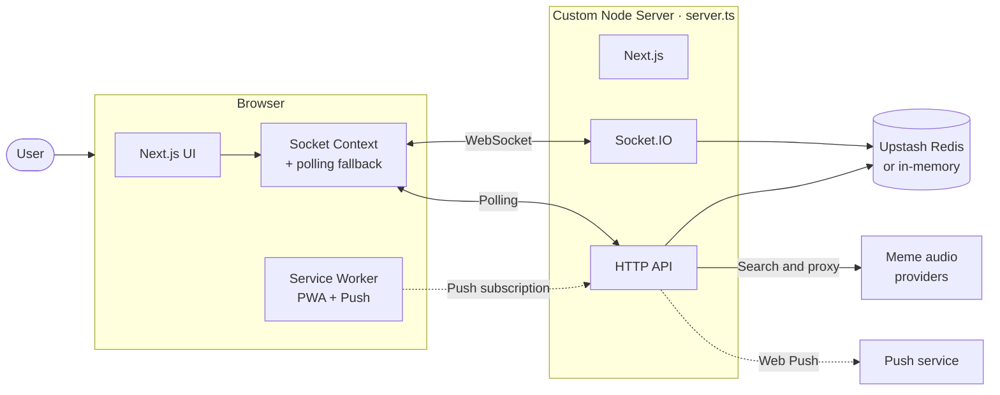
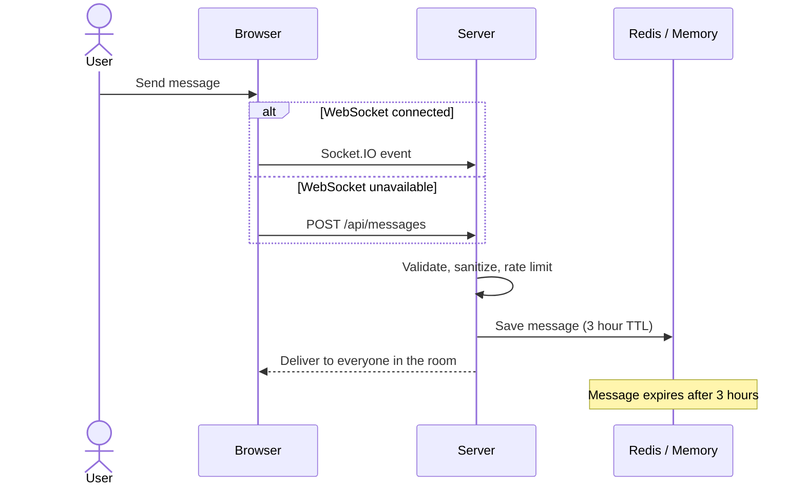

<div align="center">

# Wisp

**Anonymous, ephemeral real-time chat. No account, no history, no trace.**




</div>

---

## Overview

Wisp lets anyone jump into a chat in seconds. Your nickname is generated in the browser, you create or join a four-digit room, and you talk with text or meme audio. Rooms expire after 24 hours and messages after 3 hours, so conversations disappear on their own.

It can be installed as a PWA and works without Redis for local development.

---

## Features

| Area | Highlights |
|------|------------|
| **Anonymity** | Nicknames generated and stored in the browser, no sign-up |
| **Rooms** | Four-digit room keys, memorable room names, recent rooms list (up to 20) |
| **Messaging** | Real-time Socket.IO with HTTP polling fallback, reply-to-message, swipe and drag gestures on mobile |
| **Meme audio** | Search across MyInstants, Voicy, 101Soundboards, Freesound, Pixabay, and Mixkit |
| **Safety** | Text sanitization, profanity filter, spam detection, server-side rate limiting, safe audio URL validation |
| **Notifications** | Optional Web Push |
| **Storage** | Optional Upstash Redis with automatic in-memory fallback |
| **Experience** | Installable PWA with offline app shell, light and dark themes, sound effects, haptic feedback |

---

## How It Works



### Message Flow



Clients on the polling path fetch new messages with `GET /api/messages`.

### Data Retention

| Data | Lifetime |
|------|----------|
| Rooms | 24 hours |
| Messages | 3 hours (up to 200 recent message IDs per room) |
| Push subscriptions | Until removed or expired |
| Presence and rate-limit keys | Short-lived |

Without Redis credentials, the same data lives in process memory. That is fine for development, but it is cleared on restart and does not work across multiple instances.

---

## Quick Start

### Prerequisites

- Node.js 20 or later and npm
- Upstash Redis (recommended for hosted deployments)
- VAPID keys (only needed for Web Push)

### Run locally

```bash
git clone https://github.com/Tejas164321/Wisp.git
cd Wisp
npm install
cp .env.example .env.local
npm run dev
```

Open [http://localhost:3000](http://localhost:3000). The app runs without Redis or push credentials.

### Scripts

| Command | Description |
|---------|-------------|
| `npm run dev` | Start the custom Next.js and Socket.IO server in development |
| `npm run build` | Create the production build |
| `npm start` | Start the server in production mode |
| `npm run lint` | Run ESLint |
| `npm run clean` | Clean Next.js build output |

The server listens on port `3000` and binds to `0.0.0.0` by default. Set `HOSTNAME` to bind to a specific interface.

---

## Configuration

Set these in `.env.local` for local development, or in your hosting provider's settings.

| Variable | Required | Purpose |
|----------|----------|---------|
| `UPSTASH_REDIS_REST_URL` | Recommended | Upstash Redis REST endpoint |
| `UPSTASH_REDIS_REST_TOKEN` | Recommended | Upstash Redis token |
| `NEXT_PUBLIC_VAPID_PUBLIC_KEY` | Optional | Public VAPID key for Web Push subscriptions |
| `VAPID_PRIVATE_KEY` | Optional | Server-only VAPID private key |
| `APP_URL` | Optional | Public app URL used for Web Push VAPID details |
| `GEMINI_API_KEY` | Optional | Reserved for AI Studio and runtime integrations |

> **Never commit** `.env.local`, Redis tokens, or private VAPID keys.

To enable Web Push, generate a key pair:

```bash
npx web-push generate-vapid-keys
```

Put the public key in `NEXT_PUBLIC_VAPID_PUBLIC_KEY` and the private key in `VAPID_PRIVATE_KEY`. Only the public key is exposed to the browser.

---

## HTTP API

| Endpoint | Description |
|----------|-------------|
| `GET /api/messages` | Fetch room history and refresh presence. Params: `roomKey` (required), `nickname`, `clientId` |
| `POST /api/messages` | Send a text or meme-audio message through the polling path. Requires `roomKey`, `nickname`, and `text` (or `type: "meme_audio"` with a `memeAudio` object) |
| `POST /api/push` | Save a push subscription. Body needs `clientId` and `subscription` |
| `DELETE /api/push?clientId=...` | Remove a push subscription |
| `GET /api/memes?query=...` | Search meme-audio providers (results briefly cached in memory) |
| `GET /api/memes/stream?url=...` | Rate-limited audio proxy for approved MyInstants URLs, with byte-range support |

Example:

```bash
curl 'http://localhost:3000/api/messages?roomKey=1234&clientId=local-client'
```

```json
{ "messages": [], "onlineCount": 1 }
```

Optional `POST /api/messages` fields: `clientId`, `replyToId`, `replyToNickname`, `replyToText`.

---

## Rules and Limits

- Room keys must be exactly four digits.
- Socket messages are limited to one every five seconds per connection. Polling uses the same limit through Redis when available.
- Empty messages, spam, unsupported audio providers, invalid URLs, and oversized payloads are rejected.
- Audio URLs must use HTTPS and match an approved provider host and path or extension rule.
- All validation runs on the server, because client-side checks are not a security boundary.

---

## Project Structure

```
Wisp/
├── app/                      # Next.js pages and API routes
│   └── page.tsx              # Main chat experience
├── components/               # Reusable UI components
├── context/
│   ├── SocketContext.tsx     # Socket.IO, rooms, messages, polling fallback
│   └── ThemeContext.tsx      # Theme preference
├── hooks/
│   └── usePushNotifications.ts
├── lib/                      # Redis, validation, message, room, audio helpers
├── public/                   # PWA manifest, icons, sw.js
├── scripts/                  # Local utility scripts
└── server.ts                 # HTTP + Next.js + Socket.IO entry point
```

The browser stores the nickname, client ID, active room, and up to 20 recent rooms in `localStorage`. These are not authentication credentials.

---

## Deployment

Wisp needs a **long-running Node.js process** because Socket.IO runs inside the custom server. Deploy it as a Node service, not a static-only Next.js export.

```bash
npm ci
npm run build
npm start
```

1. Set the environment variables in your hosting platform.
2. Expose port `3000`, or use the platform's port mapping.
3. Set `APP_URL` to your public HTTPS origin if you use Web Push.

For multiple instances, use a shared Redis database and a Socket.IO setup that supports cross-instance events and sticky sessions. The in-memory fallback only works for a single process.

---

## Security and Privacy

- Wisp is anonymous, but it does not guarantee strong anonymity. Network operators, hosting providers, and upstream services may still see traffic.
- Do not share secrets or sensitive personal information in rooms.
- Keep Redis and VAPID credentials on the server.
- External audio URLs are validated to reduce SSRF and unsafe media risks, but provider availability can change.
- Check each meme-audio provider's terms and licensing before production use.

---

## License

No license file is currently included, so the repository is all rights reserved by default. To allow others to use it, add a `LICENSE` file, for example MIT.
